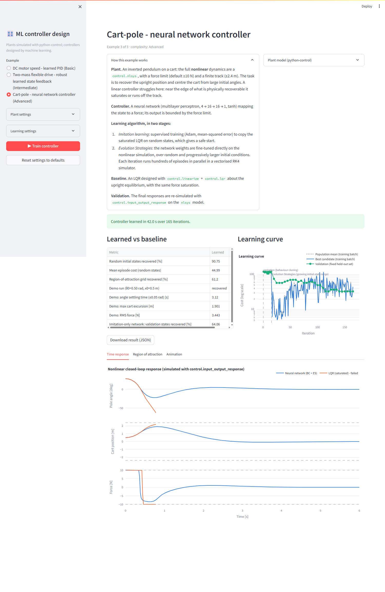

# pycontrol: controllers designed by machine learning

This project shows that a feedback controller can be **designed by a machine-learning algorithm**
that learns only from a **simulated plant** built with
[python-control](https://github.com/python-control/python-control).
Three examples of increasing complexity each define a plant, a learning algorithm that produces a
controller, and a classical baseline to compare against. A Streamlit app runs the training and
shows the graphs you need to judge the result.



## The three examples

| # | Plant | Learned controller | Learning algorithm | Baseline |
|---|---|---|---|---|
| 1 · Basic | DC motor speed (2nd-order transfer function) | PID, 3 gains | Cross-Entropy Method | Textbook hand-tuned PID |
| 2 · Intermediate | Two-mass flexible drive with uncertain parameters and unmodelled actuator lag | State feedback + integral action, 5 gains | Cross-Entropy Method with **domain randomisation** (mean + worst-case cost) | `control.lqr` on the nominal model |
| 3 · Advanced | Nonlinear cart-pole (`control.nlsys`) with force saturation and a finite track | Neural network, 4-16-16-1 | **Behaviour cloning** of LQR, then **Evolution Strategies** on the nonlinear plant | `control.linearize` + `control.lqr`, saturated |

The examples share one approach, **simulation-based policy search**: the learner proposes controller
parameters, the closed loop is simulated, a scalar cost is computed from the response, and the
learner updates its search distribution. The learner never sees the plant equations, only costs.

Typical results with default settings (see [docs/RESULTS.md](docs/RESULTS.md)):

- **DC motor:** the learned PID settles in 0.77 s with 0.6 % overshoot and a 23 V peak, within the
  48 V supply. The textbook PID is faster but needs a 1100 V spike.
- **Two-mass drive:** the learned gains keep **100 %** of 40 unseen plants stable, against 87.5 %
  for the nominal-model LQR, and settle faster on the nominal plant (1.65 s against 2.68 s).
- **Cart-pole:** the network recovers **91 %** of random large initial states against 72 % for
  LQR, and about 61 % of the initial-condition grid against 45 %. Both controllers minimise the
  same quadratic cost.

## Install

Requires Python 3.10+.

```bash
git clone https://github.com/truffio/pycontrol.git
cd pycontrol
pip install -e ".[dev]"
```

## Run the app

```bash
python -m streamlit run app/streamlit_app.py
```

1. Pick an example in the sidebar.
2. Optionally change plant or learning settings. Every setting has a sensible default.
3. Press **Train controller** and watch the live learning curve.
4. Compare learned vs baseline in the metrics table and the figure tabs (responses, Bode plot,
   uncertain-plant ensemble, closed-loop poles, region of attraction, animation, …).
5. Optionally download the trained controller and its history as JSON.

Training takes about 5 s, 12 s and 40 s for examples 1, 2 and 3 on a laptop.

## Command line

```bash
python -m mlcontrol list
python -m mlcontrol train dc_motor
python -m mlcontrol train two_mass --set uncertainty=0.4 n_iter=60
python -m mlcontrol train cart_pole --set es_iter=300 --out cart_pole.json
```

## Project layout

```
mlcontrol/
  learners.py          CEM and Evolution Strategies (antithetic sampling, rank shaping, Adam)
  policies.py          numpy MLP with batched forward pass and backprop
  plotting.py          shared Plotly style
  examples/
    base.py            Example interface: params, train(callback), evaluate()
    dc_motor.py        Example 1
    two_mass.py        Example 2
    cart_pole.py       Example 3
  cli.py               command-line runner
app/streamlit_app.py   user interface
tests/                 pytest suite (learners, each example, the app)
docs/PLAN.md           project plan
docs/RESULTS.md        results write-up
```

To add an example, subclass `mlcontrol.examples.base.Example`, declare its `params`,
implement `_train` and `evaluate`, and decorate it with `@register`. The UI and CLI pick it up
automatically.

## Tests

```bash
pytest -q
```

CI runs the suite on Python 3.10 and 3.12 for every push and pull request.
