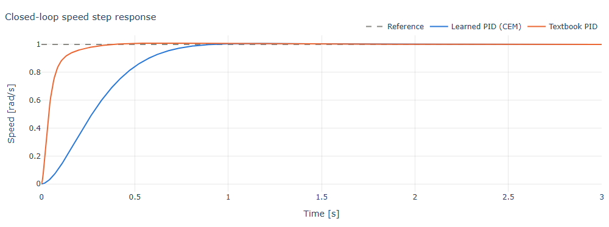
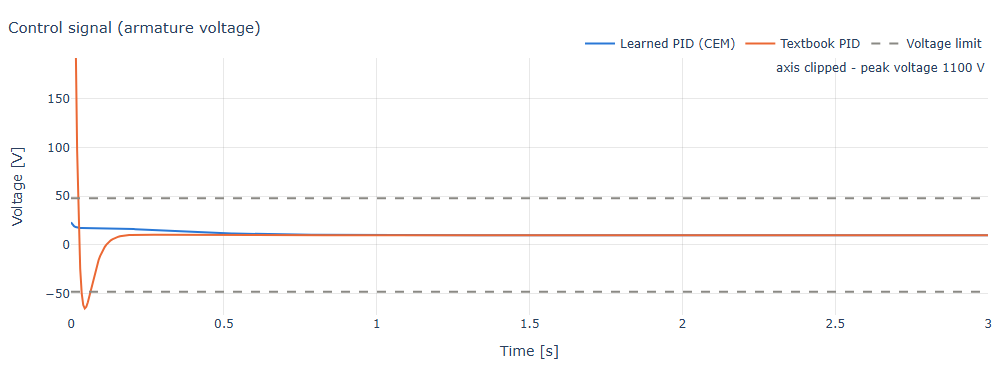
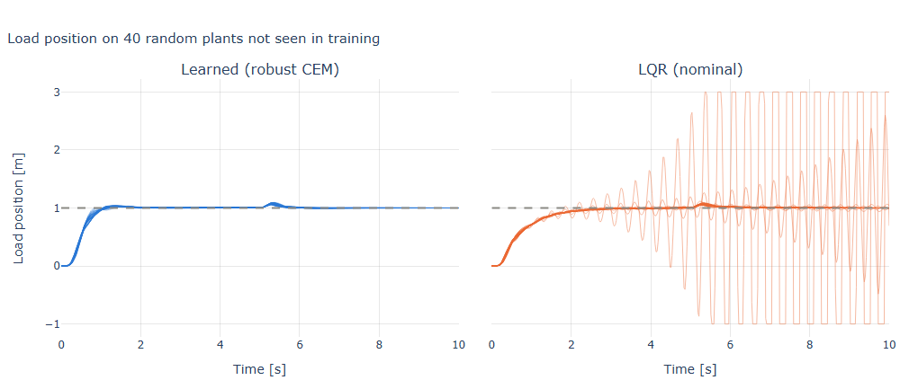
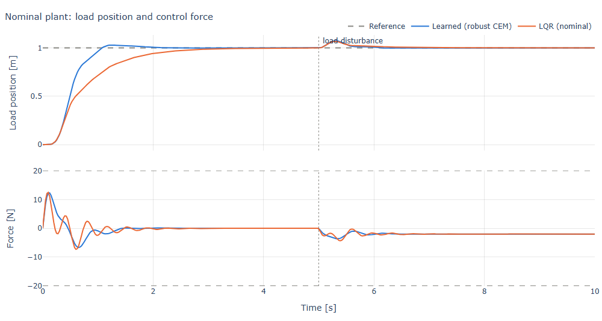
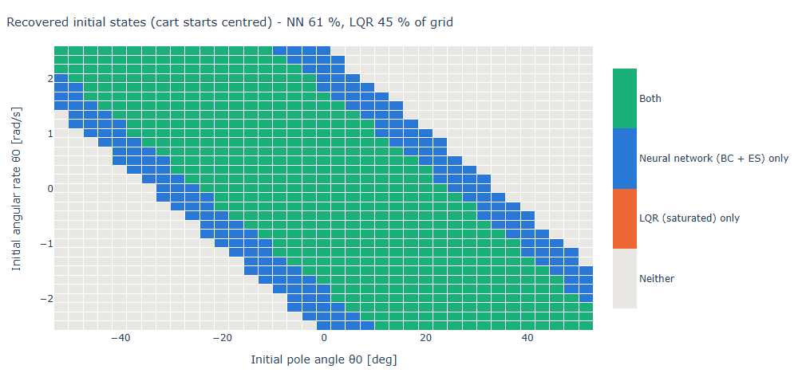
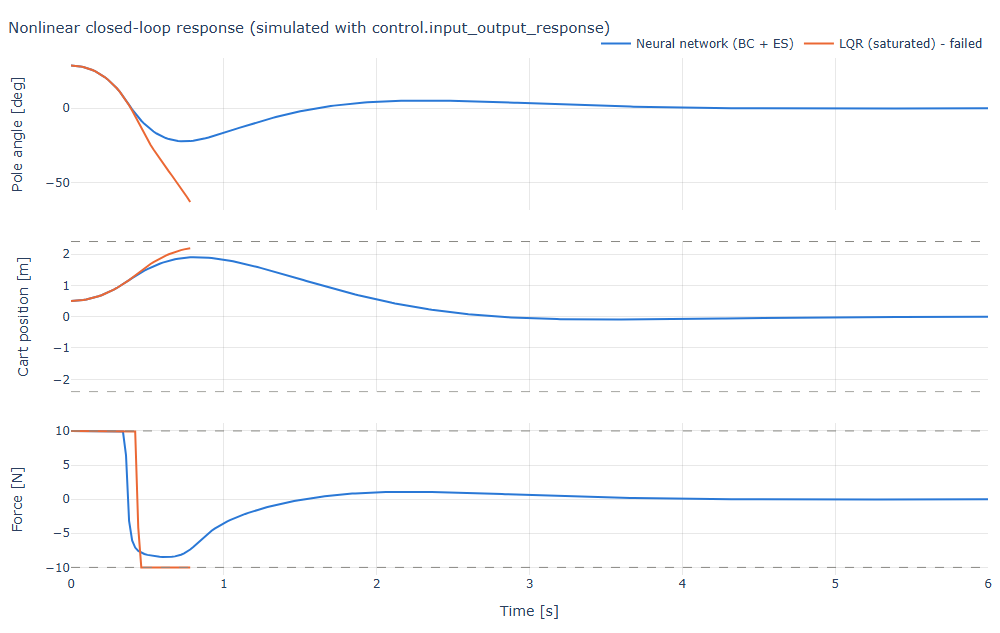

# Results

All numbers come from the default settings and seeds (`python -m mlcontrol train <example>`),
run on a Windows laptop with Python 3.11 and python-control 0.10.2. Learned controllers are
always evaluated on data they were not trained on: fresh random plants or initial states with a
fixed seed.

## Example 1: DC motor speed, learned PID

The Cross-Entropy Method tunes the PID gains in log scale from about 1,200 simulated closed-loop
step responses (30 iterations × 40 candidates, 5 s).

| Metric | Learned PID | Textbook PID |
|---|---|---|
| Gains Kp / Ki / Kd | 16.4 / 33.3 / 0.068 | 100 / 200 / 10 |
| Rise time | 0.49 s | 0.11 s |
| Settling time (2 %) | 0.77 s | 0.27 s |
| Overshoot | 0.6 % | 0.9 % |
| Peak voltage (limit 48 V) | **23 V** | 1100 V |
| Phase margin | 73° | 85° |

**Reading:** the textbook design is faster only because it ignores the supply. The learner
treats the voltage limit as part of the objective and finds the fastest well-damped response
that respects it. Probing higher gains confirms that they trade overshoot against speed, so this
is a real optimum of the stated cost and not premature convergence.

## Example 2: Two-mass flexible drive, robust learned state feedback

The simulated plant includes a 50 ms actuator lag that the classical design model omits. Load
mass and stiffness vary ±30 %, damping ×0.5–2 and the actuator time constant ×0.5–1.5. CEM with
domain randomisation draws 6 new plants per iteration (40 iterations, 12 s).

| Metric (40 unseen test plants) | Learned | LQR (nominal) |
|---|---|---|
| Plants stable | **100 %** | 87.5 % |
| Plants within force limit | **100 %** | 92.5 % |
| Mean cost | **0.038** | 125 (unstable cases) |
| Worst-case cost | **0.044** | unstable |
| Nominal settling time | 1.65 s | 2.68 s |
| Nominal peak force | 12.3 N | 12.5 N |

**Reading:** LQR is optimal for the model it is given. With full state feedback it is robust to
the parameter changes alone, but the unmodelled actuator lag destabilises it on some plants.
Because the learner is scored on a high-fidelity, randomised simulator, its gains are robust by
construction. The result carries the usual caveat of domain randomisation: robustness is only
guaranteed for the variations included in the training distribution.

## Example 3: Cart-pole, neural network controller

Both controllers minimise the same cost, x'Qx + rF² with Q = diag(10, 1, 100, 1) and r = 0.01.
LQR is optimal for the linearised, unconstrained problem. The network is trained on the true
problem: nonlinear dynamics, ±10 N force saturation and a ±2.4 m track. Training is 1,500 steps
of behaviour cloning, then 150 ES iterations (≈ 7,000 parallel episodes per minute of training,
40 s total).

| Metric | NN (BC + ES) | LQR (saturated) |
|---|---|---|
| Random initial states recovered (400, θ0 up to ±34°, x0 up to ±1 m) | **91 %** | 72 % |
| Mean episode cost (same states) | **45** | 96 |
| Region-of-attraction grid recovered (cart centred) | **61 %** | 45 % |
| Demo θ0 = 0.5 rad, x0 = 0.5 m | **recovered**, RMS force 3.4 N | failed |
| Imitation-only network (before ES) | 64 % of validation states | |

The time response above is simulated with `control.input_output_response` on the `nlsys`
model, independently of the RK4 simulator used for training. The two agree to within 0.01 rad.

**Reading:** imitation alone only reproduces LQR. The gain comes from Evolution Strategies
optimising on the real constraints: the network learns to keep the cart away from the track ends
and to avoid sitting in saturation. Open-loop trajectory optimisation from the failing states
suggests about 62 % of the grid is the physical limit with this force and track length, so the
network is close to the best any controller can do. An earlier variant with a gently tuned LQR
showed no gap at all, because that LQR was already at the limit; the comparison is only
meaningful when the linear design is pushed for performance.

## Limitations

- Learned controllers come with no formal stability or robustness certificate. They are
  validated statistically on held-out plants and initial states.
- The PID and state-feedback examples evaluate saturation as a penalty on a linear simulation.
  Only the cart-pole simulates actuator saturation directly.
- Results depend on the cost weights, which encode the designer's intent just as LQR weights do.
- Black-box search scales poorly with very many parameters. ES handles ~370 network weights
  well here; much larger networks would need gradient-based reinforcement learning.
